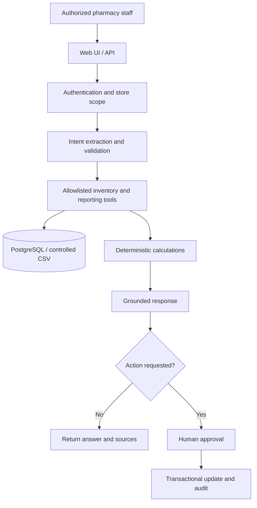

# System architecture

## Proposed stack
Learning: Python, Google Colab, LangChain, provider selected per assignment. Pilot: FastAPI, PostgreSQL, React/TypeScript, JWT or secure sessions, RBAC, background worker. Optional later: LangGraph for complex workflows, pgvector for document retrieval, OCR and scikit-learn forecasting. No vector database or multi-agent system is required for exact inventory queries.

## Data model
Store(store_id, name); User(user_id, store_id, role, active); Product(product_id, store_id, name, strength, form, sku, reorder_level); Batch(batch_id, product_id, lot_number, expiry_date, quantity, mrp, last_verified_at); Sale(sale_id, store_id, timestamp, total, status); SaleItem(sale_id, batch_id, qty, unit_price); StockMovement(id, batch_id, qty_delta, reason, actor_id, timestamp); Approval(id, store_id, actor_id, proposed_action, status); AuditEvent(id, store_id, actor_id, action, timestamp, outcome). Use decimal currency, timezone-aware timestamps and transactional updates. Product identities must distinguish strength and form. Do not store patient identifiers in MVP.

## Tool contracts
search_inventory(query, store_scope); list_low_stock(as_of, store_scope); list_expiring(days, as_of, store_scope); sales_summary(start, end, store_scope); draft_reorder(product_id, quantity). Store scope is injected by trusted server context, never chosen by the model. Validate parameters and enforce authorization in the service. Mutations use separate approval endpoints, idempotency keys and transaction checks.

## Proposed API
GET /inventory; GET /inventory/low-stock; GET /inventory/expiring; GET /reports/sales; POST /assistant/query; POST /approvals; POST /approvals/{id}/approve. API paths are design proposals, not implemented endpoints.

## Reliability
Fail closed on missing/stale data, return sources and as-of time, protect against prompt injection in uploaded documents, validate outputs, log failures without secrets, rate-limit and test tenant isolation. Avoid raw model-generated SQL. Use ordinary code for exact arithmetic, stock filtering and expiry windows. Forecast later using baseline comparison and time-series backtesting.
